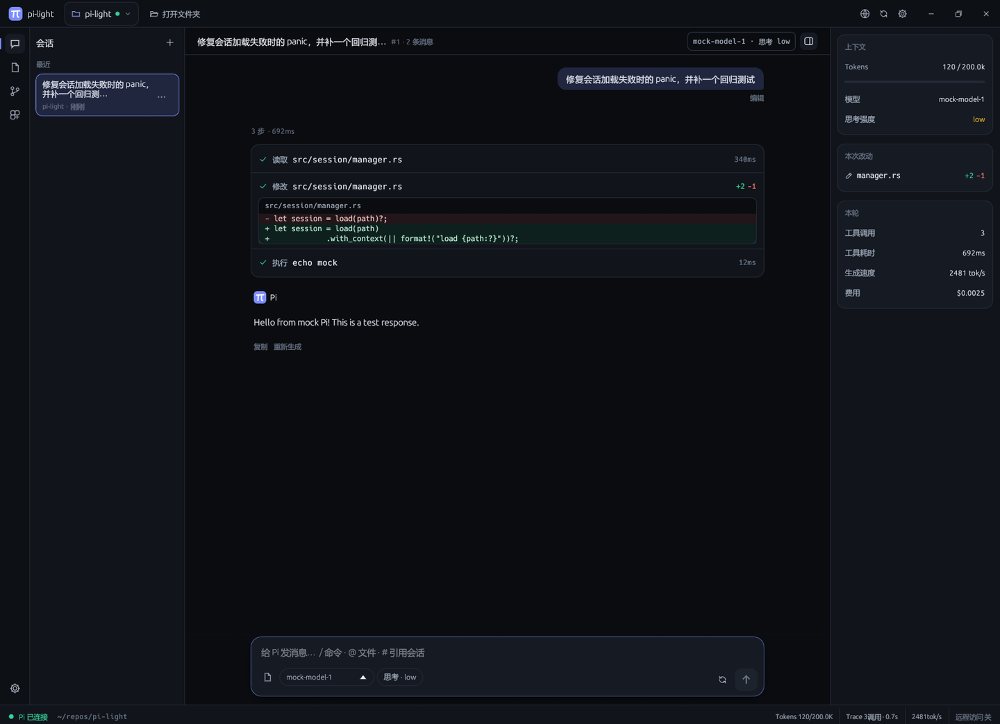
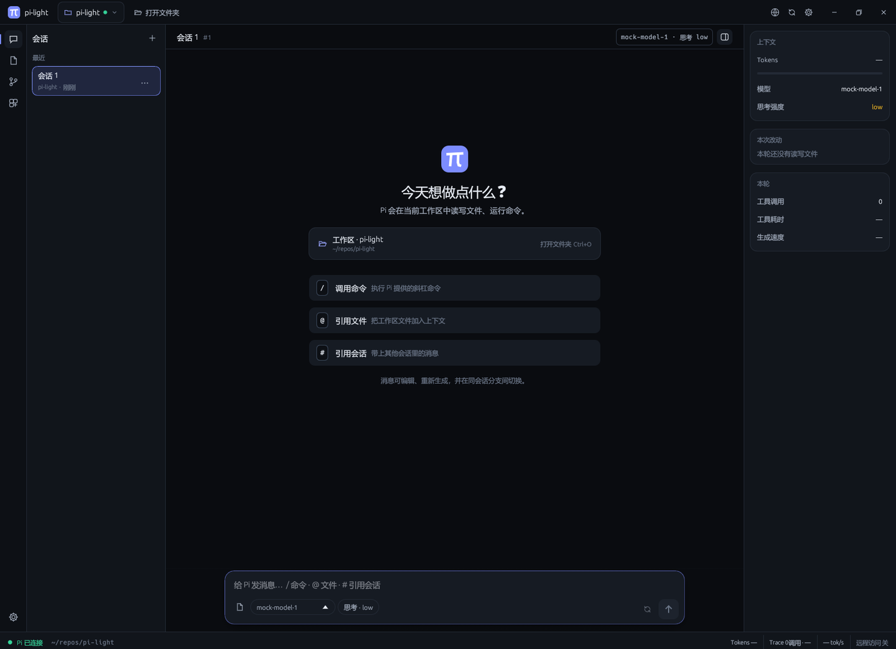
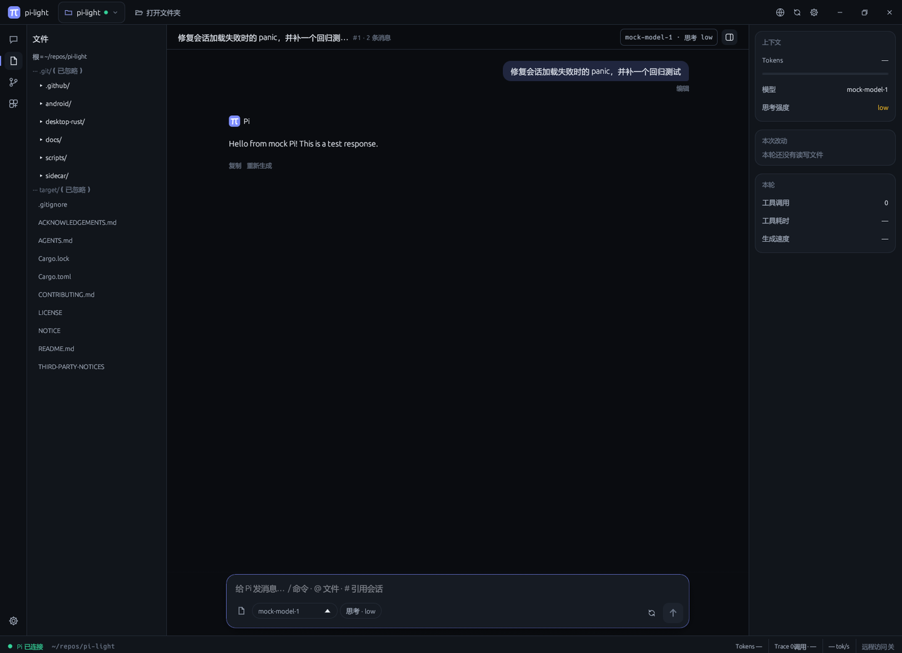
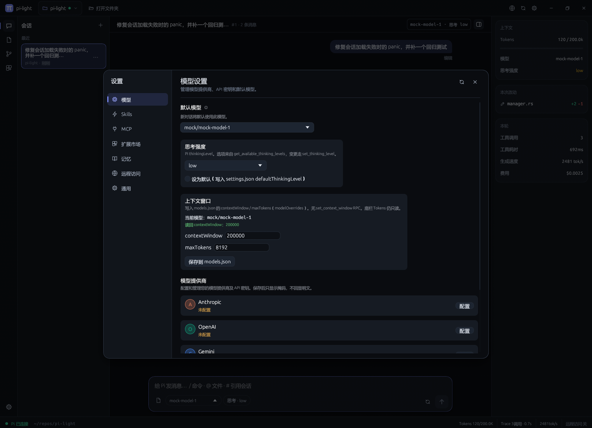
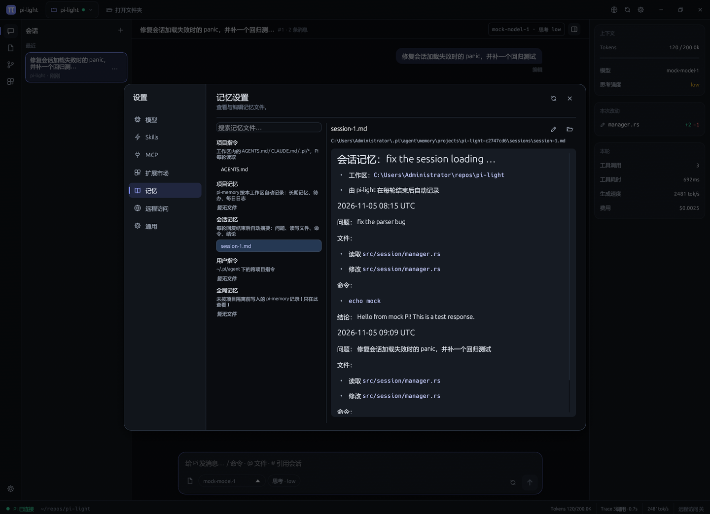
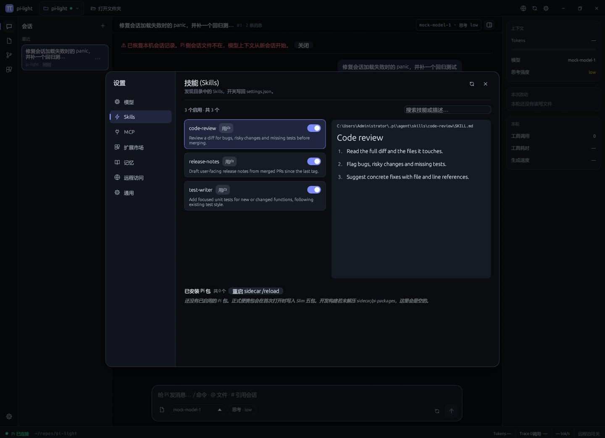
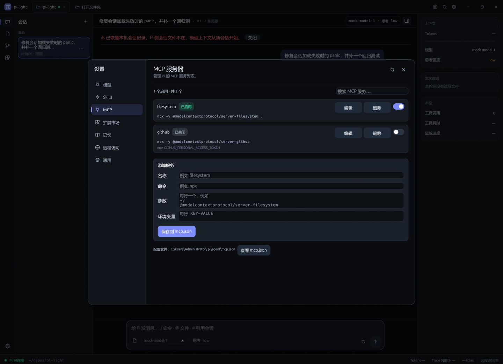

# pi-light

**内嵌官方 Pi sidecar 的轻量 Rust 桌面 Agent（egui / eframe，Apache-2.0 洁净室）。**

用户入口是一个原生窗口：`pi-light.exe` 拉起官方 [Pi coding agent](https://github.com/earendil-works/pi)（`pi --mode rpc`），用 JSONL 做流式对话。正式发行是 Windows x64 便携 zip；Android companion 经公网中继写入同一桌面会话。

[](https://github.com/ningyanhui/pi-light/actions/workflows/ci.yml)
[](https://github.com/ningyanhui/pi-light/actions/workflows/release.yml)
[](https://github.com/ningyanhui/pi-light/actions/workflows/android-apk.yml)
[](./LICENSE)

当前版本：**v0.3.2**（Windows 便携包为主路径）。



---

## 目录

1. [它是什么](#1-它是什么)
2. [界面一览](#2-界面一览)
3. [能做什么](#3-能做什么)
4. [安装与使用](#4-安装与使用)
5. [架构](#5-架构)
6. [从源码构建](#6-从源码构建)
7. [许可](#7-许可)
8. [文档索引](#8-文档索引)

---

## 1. 它是什么

pi-light 把官方 Pi（MIT，钉定 **v1.4.0**）以 sidecar 方式嵌进 [egui](https://github.com/emilk/egui) / eframe 桌面窗。

- **单一入口**：`pi-light.exe`。壳是 Apache-2.0 洁净室自写的 Rust 程序，主路径在 `desktop-rust/`。
- **本地进程**：`std::process::Command` 启动 `pi` / `pi.exe --mode rpc`，stdin/stdout 走官方 JSONL，后台线程读 stdout，UI 每帧 drain。
- **便携发行**：Windows zip 带上 Pi sidecar、MinGit bash、Slim 预置包与 Cloudflare Tunnel 客户端。正式包不含 Node 运行时，解压即可跑。
- **手机伴侣**：`android/` 是 debug companion APK，扫码或输码后经公网中继写入当前桌面 Pi 会话；不内嵌 Pi。

平台：Windows x64 为正式发行目标；Linux / macOS 可开发调试。

许可分层：壳 **Apache-2.0**；Pi 仍为 MIT；MinGit 仍为其原许可。摘要与版权见 [`NOTICE`](./NOTICE)。

---

## 2. 界面一览

> 以下截图全部来自当前版本的 Windows 构建。后端用的是仓库自带的测试替身 `mock-pi`，所以回复是固定文本；界面和交互与接入真实 Pi 时一致。

| 新会话：工作区卡片与 `/` `@` `#` 快捷方式 | 对话：工具时间线 + 内联 diff + 右侧上下文 |
|---|---|
|  |  |
| **文件树**：根目录是当前工作区，单击文件即插入路径 | **设置 · 模型**：居中面板 + 左侧分类导航 |
|  |  |
| **记忆**：按来源分组，可看全文 / 编辑；会话记忆每轮自动写入 | **Skills**：显示描述、来源、开关，点击可看 SKILL.md 全文 |
|  |  |
| **MCP**：编辑 command / args / env，删除，查看 mcp.json | |
|  | |

---

## 3. 能做什么

### 外观与布局

- **无边框标题栏**：标题栏是自绘的，包含品牌、工作区下拉（含最近打开的文件夹）、「打开文件夹」、远程 / 重新探测 / 设置图标，以及最小化、最大化、关闭按钮。拖动空白处移动窗口，双击最大化或还原，窗口四边都能拖动缩放。
- **图标导航栏 + 侧栏**：左侧 48px 导航栏可切换 会话 / 文件 / Git，再点一次当前图标就收起侧栏。扩展市场和设置的入口也在导航栏里。
- **右侧上下文面板**：显示 Token 用量、模型、思考强度、本轮读写过的文件和工具调用统计。窗口足够宽时默认展开，会话标题栏上有按钮可以开关。
- **深色设计系统**：近黑底色，配靛蓝 / 青色强调色，圆角和描边统一；图标全部是自绘的线条图标，不依赖字体里有没有对应字形。Windows 版嵌入了品牌图标。

### 对话工作台

- **流式对话**：真实接入官方 JSONL RPC。生成过程中可以停止，空闲时可以重发上一条 prompt。
- **多会话**：会话在侧栏按「最近 / 更早」分组，「⋯」菜单里有 打开 / Fork / 引用 / 重命名 / 删除。新建和切换时壳会发 `new_session` / `switch_session`。会话列表、消息树、草稿和每个会话的工作区都写入 `~/.pi-light/sessions.json`（可用 `PI_LIGHT_STATE_PATH` 改路径），下次启动时读回；如果对应的 Pi 会话文件还在，会直接切回去。
- **工作区**：切换工作区用系统原生的「打开文件夹」对话框，入口有标题栏按钮、`Ctrl+O` 和欢迎页卡片；也可以直接把文件夹拖进窗口，最近打开过的文件夹会保留在下拉里。**同一时间只有一个活动工作区**，切换后文件树和 Git 会跟着刷新。新路径和当前一样时复用现有 sidecar；路径变了就重启 sidecar，在新目录下运行（Pi v1.4.0 没有 `set_cwd`）。
- **文件树**：根目录是当前工作区，可以展开两级以上，默认忽略 `node_modules`、`.git`、`target` 等巨型目录。单击文件会把它的相对路径插入输入框。
- **Git**：Changes 页显示 `git status` 风格的列表，可以在系统文件管理器里显示文件，支持最基本的 stage / unstage / commit。History 页显示最近 50 条提交的短 hash、标题、作者和时间。不是 git 仓库时会如实显示为空。
- **同会话消息树**：编辑用户消息或重新生成助手回复，会在同一会话里分出兄弟分支，可以在分支间切换。消息树由壳维护（Pi v1.4.0 没有同会话的 `navigate_tree`），改写或切换分支后会把当前路径重新回放给 Pi。
- **工具时间线**：每次工具调用显示为一行，标明 读取 / 执行 / 修改 / 写入 / 搜索、状态和耗时；修改类步骤直接内联显示 +/- diff，长 diff 可以展开。这些信息来自 `tool_execution_*` 事件的参数摘要。
- **浮动输入框**：包含引用 chip、模型、思考强度、重新生成、发送 / 停止。
- **`#` 引用**：输入 `#` 可以引用当前会话的消息或本机的历史会话文件，选中的 chip 会拼进 prompt 一起发送。
- **用量**：底栏和右侧面板显示 Pi 上报的 Token、工具 Trace 和吞吐（来自 `message_update.usage` / `get_session_stats`）。
- **中文**：Windows 上用微软雅黑等系统 CJK 字体作为 egui 的回退字体；也可以用 `PI_LIGHT_CJK_FONT` 指定字体文件。

### 设置、模型与扩展

点标题栏或导航栏的齿轮，会打开**居中的设置面板**，左侧有七个分类：

| 分类 | 做什么 |
|-----|--------|
| 模型 | 内置厂商卡片，以及「自定义模型 API」（Provider ID / Base URL / 协议 / 模型目录）。密钥写入 Pi 的 `auth.json`，自定义端点另外写入 `models.json`。保存后输入框会清空，已保存的密钥只显示掩码 `••••••••`，不回显明文，也不会出现在错误信息里。这个表单不会覆盖 OAuth 登录；环境变量和 Pi 的 `/login` 仍然可用。Unix 上 `auth.json` 的权限是 `0600`。添加提供商的对话框宽度固定，内容在框内滚动。 |
| Skills | 卡片显示 SKILL.md 的描述和来源（项目 / 用户），点击可在右侧查看全文。开关写回 `settings.json` 的 `skills` 数组，改动后重启 sidecar。页面里还能查看和移除已安装的 Pi 包。 |
| MCP | 卡片显示 command、args 和 env 的键名。新增和编辑时可以填参数（每行一个）和环境变量（每行 `KEY=VALUE`），删除前会二次确认，也可以直接查看 `mcp.json`。读写官方的 `enabled` 字段（兼容旧的 `disabled`），改动后重启 sidecar。 |
| 扩展市场 | 浏览、搜索，按 Extension / Skill / Prompt / Theme 筛选。详情卡展示许可证、关键词、install 脚本等注册表元数据，确认后由 sidecar 执行 `pi install npm:…`；已安装的包可以列出和移除。目录来源和 [pi.dev/packages](https://pi.dev/packages) 相同（npm 上的 `pi-package`）。 |
| 记忆 | 文件分为 项目指令 / 项目记忆 / 会话记忆 / 用户指令 / 全局记忆 五组，可查看 markdown 全文、编辑后写回，或在文件管理器中显示。 |
| 远程访问 | 允许手机远程连接、配对码 / 二维码、启停 Cloudflare Tunnel，已授权的设备可以撤销。浏览、触控、全屏三种远程桌面模式都走同一个中继。 |
| 通用 | 可以打开「显示首次引导」（默认关）。Pi 程序位置等高级项（环境变量、sidecar 目录、PATH）收在折叠区里。 |

标题栏和输入框都能切换模型，可选项来自 Pi 上报的可用模型列表。

**Slim 预置**（正式便携包 `sidecar/pi-packages/`，首次打开写入本地 path）：

- 默认启用：`pi-marketplace` 0.1.3、`pi-mcp-adapter` 7.0.0、`pi-web-access` 0.46.0、`pi-memory` 0.4.2、`pi-subagents` 0.84.0
- 预置文件、默认关闭，市场页可一键启用：`pi-browser-use` 0.12.15、`pi-chrome-connector` 0.2.2、`@injaneity/pi-computer-use` 0.5.1（启用前先走 Windows 权限向导：辅助功能 / 截屏 / 模拟输入）

钉版本与 tarball SHA-256 见 [`NOTICE`](./NOTICE) 与 [`docs/preset-packages.md`](./docs/preset-packages.md)。`PI_LIGHT_PACKAGES_DIR` 可覆盖预置树路径。

### 记忆

- **项目记忆按工作区隔离**：存放在 `~/.pi/agent/memory/projects/<目录名>-<路径哈希>/`。启动 Pi 时壳会注入 `PI_MEMORY_DIR` 指向这里（如果你自己设置过这个变量，就不会覆盖）。内置的 `pi-memory` 写入的 `MEMORY.md`、`SCRATCHPAD.md` 和 `daily/*.md` 因此都归属当前项目，切换工作区时会一起切换。
- **会话记忆自动写入**：每轮回复结束后，壳会把用户的问题、读写过的文件、执行过的命令和结论追加到 `sessions/session-<id>.md`，这一步不额外调用模型。
- **全局偏好**：写在用户级的 `~/.pi/agent/AGENTS.md`，所有项目共用。

### 远程访问与 companion

桌面「远程访问」打开本机 loopback 网关（默认 `127.0.0.1:17831`），再用 **Cloudflare Tunnel** 引出公网 HTTPS。默认临时 trycloudflare，无需 Cloudflare 账号；命名隧道、Tailscale、自建入口可手填。

- 6 位配对码，TTL 10 分钟；二维码携带配对码与中继 URL。
- 手机扫码，或手输配对码 **和** 中继 URL；`POST /v1/pair/claim` 成功后进入已授权设备，可撤销。
- 已授权设备 `POST /v1/chat`（`Authorization: Bearer <token>`）写入**当前**桌面 Pi 会话。
- 已授权设备可进入远程桌面：浏览只看画面，触控 / 全屏把点按与滑动映射到桌面键鼠；画面走 `/v1/desktop/*`。
- 官方 Windows 包打入校验过 SHA 的 `cloudflared`；源码构建可在本页按钉版本下载。

Android companion 不内嵌 Pi，完整会话仍在桌面。配对、聊天与远程桌面协议见 [`docs/companion-protocol.md`](./docs/companion-protocol.md)，公网剧本见 [`docs/remote-acceptance.md`](./docs/remote-acceptance.md)。

---

## 4. 安装与使用

### Windows 便携包

从 [Releases](https://github.com/ningyanhui/pi-light/releases) 下载 `pi-light-windows-x64.zip`，解压后运行 `pi-light.exe`。不必再装 Node.js，也不必手敲 `pi install`。

```
pi-light-windows-x64/
├── pi-light.exe              # 唯一用户入口
├── NOTICE                    # Pi / MinGit / 预置包 / cloudflared 的 SHA-256 与版权
├── LICENSE                   # Apache-2.0
└── sidecar/
    ├── pi/pi.exe             # 官方 Pi v1.4.0（打包前校验 SHA-256）
    ├── bash/                 # MinGit（sh.exe；打包复制为 bash.exe）
    ├── pi-packages/          # Slim 五包（默认启用）+ 操控三包（默认关闭）
    └── relay/cloudflared.exe # Cloudflare Tunnel 客户端（打包前校验 SHA-256）
```

SHA-256 以仓库根目录 [`NOTICE`](./NOTICE) 与 [`docs/preset-packages.md`](./docs/preset-packages.md) 为准。Release 下载后核对摘要，失败则拒绝打包。签名与分发说明见 [`docs/signing.md`](./docs/signing.md)。

### 第一次打开

官方便携包已经带好 Pi。启动后默认进入对话，**不会**自动弹出模型引导。

1. 程序在 `pi-light.exe` 旁边找到 `sidecar/pi/pi.exe` 后，主界面依次是左侧图标导航与侧栏（会话 / 文件 / Git）、中央对话区和右侧上下文面板。还没打开工作区时，点「打开文件夹」选择项目目录。
2. 模型与 API 密钥在「设置」（导航栏底部齿轮）→「模型」里配置：内置厂商或「自定义模型 API」。
3. 若要再看引导页：设置 →「通用」打开「显示首次引导」（默认关，记在 `pi_light.show_onboarding`）。
4. 若这次没找到 Pi：主界面说明便携包应已包含它，并提供「重新探测」。自己指定 Pi 程序收在折叠高级区。

### 日常使用

1. 在输入框写消息，Enter 或发送按钮提交；生成中点「停止」，空闲时点「重试」。消息上可编辑 / 重新生成，并在同会话内切换分支。
2. 输入 `#` 挑选本会话或历史消息，chip 会跟 prompt 一起发出。
3. 在侧栏新建 / 切换会话。切换工作区可以点标题栏「打开文件夹」、按 `Ctrl+O`，或把文件夹拖进窗口。
4. 在标题栏或输入框切换模型。
5. 需要装包时打开「扩展市场」，在详情卡确认后再安装。

### 手机远程聊天与桌面

1. 桌面「设置」→ **远程访问** → 打开「允许手机远程」，等到中继状态为已连接（默认出现 `https://….trycloudflare.com`）。
2. 手机使用能访问该公网主机名的网络（公网验收用蜂窝数据）。
3. 打开 companion，扫描桌面二维码，或手输 6 位配对码和中继 URL。
4. 进入会话发一条消息；桌面同一 Pi 会话应出现来回。
5. 首页「远程桌面」进入浏览 / 触控 / 全屏，查看并（在后两档）操控桌面。

临时 trycloudflare 每次启动主机名会变，重新扫码即可。命名隧道可固定主机名。配置落在 `~/.pi-light/remote.json`（`PI_LIGHT_REMOTE_PATH` 可覆盖）。

Android APK 由 [android-apk](https://github.com/ningyanhui/pi-light/actions/workflows/android-apk.yml) 工作流构建 `assembleDebug` 产物。本地步骤见 [`android/README.md`](./android/README.md)。

### Pi 程序位置（高级）

只有便携包里没有 Pi，或你要改用别的程序时才需要：

1. 环境变量 `PI_LIGHT_PI_BIN`
2. `{exe_dir}/sidecar/pi/pi.exe`（Windows）或 `{exe_dir}/sidecar/pi/pi`（其他）
3. 本机 `PATH` 中的 `pi` / `pi.exe`

cloudflared 探测顺序：`PI_LIGHT_CLOUDFLARED` → `{exe_dir}/sidecar/relay/` → `~/.pi-light/relay/` → `PATH`。

### 开发调试

```bash
git clone https://github.com/ningyanhui/pi-light.git
cd pi-light/desktop-rust
export PI_LIGHT_PI_BIN=/path/to/pi   # 或 Windows 上的 pi.exe
cargo run
```

---

## 5. 架构

主路径是 `desktop-rust/`（egui / eframe）。壳 spawn Pi，JSONL 走管道，后台线程读 stdout。

```
┌─────────────────────────────────────────────────────────────┐
│  desktop-rust/   egui + eframe                               │
│  标题栏：工作区切换 · 打开文件夹 · 远程 / 设置 · 窗口按钮        │
│  图标导航 + 侧栏：会话 / 文件树 / Git（Changes + History）     │
│  主区：流式对话 + 工具时间线 / 内联 diff + 浮动输入框 + 右栏上下文 │
│  设置面板：模型 / Skills / MCP / 扩展市场 / 记忆 / 远程 / 通用   │
└────────────────────────────┬────────────────────────────────┘
                             │ Command + JSONL stdin/stdout
                             ▼
┌─────────────────────────────────────────────────────────────┐
│  Pi sidecar（官方 MIT，不改源码）                              │
│  pi --mode rpc   可选 cwd；已有会话文件则 switch_session       │
└─────────────────────────────────────────────────────────────┘

android/   Kotlin Compose companion（配对 + /v1/chat + /v1/desktop）
```

```
desktop-rust/src/
├── main.rs              # egui App：标题栏、图标导航、对话布局、输入框
├── chat_view.rs         # 消息 / 思考块 / 分支导航渲染
├── app_screens.rs       # 全屏状态页（模型引导、Pi 缺失、启动失败）
├── timeline_ui.rs       # 工具时间线、内联 diff、右侧上下文面板
├── tool_step.rs         # 工具参数 → 步骤类型 / 目标 / diff 摘要
├── icons.rs             # 自绘线条图标
├── workspace.rs         # 侧栏（会话分组 / 文件 / Git）、cwd 切换
├── workspace_tree.rs    # 文件树
├── workspace_git.rs     # Git Changes / History
├── theme.rs             # 深色设计令牌与共用控件
├── app_icon.rs          # 窗口与 Windows exe 品牌图标
├── fonts.rs             # 系统 CJK 字体回退
├── pi_path.rs           # Pi 三态路径探测
├── bash_path.rs         # 便携 bash 探测与 PATH 注入
├── pi_rpc.rs            # JSONL RPC（spawn 可带 cwd）
├── chat.rs              # 聊天状态机 + SessionHub
├── message_tree.rs      # 同会话消息树（壳侧）
├── session_store.rs     # 会话历史落盘与启动恢复
├── session_insights.rs  # Token / Trace
├── admin_panel.rs       # 设置面板（七个分类）
├── admin_panel/views.rs # 各分类页渲染
├── admin_panel/extensions.rs # Skills 描述、MCP args / env 读写
├── memory_store.rs      # 按工作区隔离的记忆目录、会话记忆自动写入
├── ext_market.rs        # 扩展市场浏览 / 详情 / 确认安装 / 一键启用
├── pi_pkg.rs            # sidecar `pi install` / `list` / `remove`
├── preset_packages.rs   # Slim 预置同步、操控包启用
├── api_keys.rs          # 应用内 API 密钥（掩码，不回显明文）
├── provider_catalog.rs  # 内置厂商 + 自定义 API / models.json
├── onboarding.rs        # 启动主路径：默认进对话，引导可选手动打开
├── session_ref.rs       # # 引用
├── remote_access.rs     # 远程访问页：配对码 / 二维码 / 设备
├── desktop_stream.rs    # JPEG 编码、Windows 主屏捕获、键鼠注入
├── remote_gateway.rs    # 本机 loopback 控制面（claim + /v1/chat + /v1/desktop）
├── relay_mgr.rs         # cloudflared 探测、下载、quick tunnel
└── bin/mock_pi.rs       # 测试替身
```

完整层次与模块职责见 [`docs/architecture.md`](./docs/architecture.md)。

---

## 6. 从源码构建

要求：Rust stable（edition 2021）；Linux 构建需系统 OpenGL / X11 头文件（见 CI）。

```bash
cd desktop-rust
cargo fmt --check
cargo clippy --all-targets -- -D warnings
cargo test --all-targets
cargo build --release
```

集成测试使用 `mock-pi` 替身，不依赖真实 Pi 二进制。

Android companion（JDK 17+、Android SDK；`testDebugUnitTest` + `assembleDebug`）：

```bash
cd android
./gradlew assembleDebug
# 产物: app/build/outputs/apk/debug/app-debug.apk
```

贡献约定见 [`CONTRIBUTING.md`](./CONTRIBUTING.md) 与 [`AGENTS.md`](./AGENTS.md)。

---

## 7. 许可

本项目以 **Apache-2.0** 发布。

- Pi sidecar：[earendil-works/pi](https://github.com/earendil-works/pi)（MIT），嵌入不改源码
- egui / eframe：[emilk/egui](https://github.com/emilk/egui)（MIT OR Apache-2.0，本项目用 Apache-2.0 条款）
- MinGit for Windows：便携 bash 环境，原许可见包内与 [`NOTICE`](./NOTICE)

致谢见 [`ACKNOWLEDGEMENTS.md`](./ACKNOWLEDGEMENTS.md)。

---

## 8. 文档索引

| 文档 | 说明 |
|------|------|
| [`docs/architecture.md`](./docs/architecture.md) | 架构、模块、里程碑 |
| [`docs/ui-system.md`](./docs/ui-system.md) | 桌面与 Android 共用视觉系统、布局和交互规则 |
| [`docs/workspace.md`](./docs/workspace.md) | 工作区 cwd：无感知切换与上游限制 |
| [`docs/remote-acceptance.md`](./docs/remote-acceptance.md) | 公网远程配对、中继启停与验收剧本 |
| [`docs/companion-protocol.md`](./docs/companion-protocol.md) | companion 配对 / claim / `/v1/chat` / `/v1/desktop` |
| [`docs/preset-packages.md`](./docs/preset-packages.md) | Slim / 操控预置包钉版本与 tarball SHA-256 |
| [`docs/signing.md`](./docs/signing.md) | Windows / Android 签名与分发策略 |
| [`android/README.md`](./android/README.md) | companion 构建与配对步骤 |
| [`AGENTS.md`](./AGENTS.md) | 洁净室规则（给贡献者与编码代理） |
| [`CONTRIBUTING.md`](./CONTRIBUTING.md) | 贡献指南 |
| [`ACKNOWLEDGEMENTS.md`](./ACKNOWLEDGEMENTS.md) | 第三方致谢 |
| [`NOTICE`](./NOTICE) | Pi / MinGit / 预置包 SHA-256 与版权 |
| [`THIRD-PARTY-NOTICES`](./THIRD-PARTY-NOTICES) | 依赖许可清单 |
